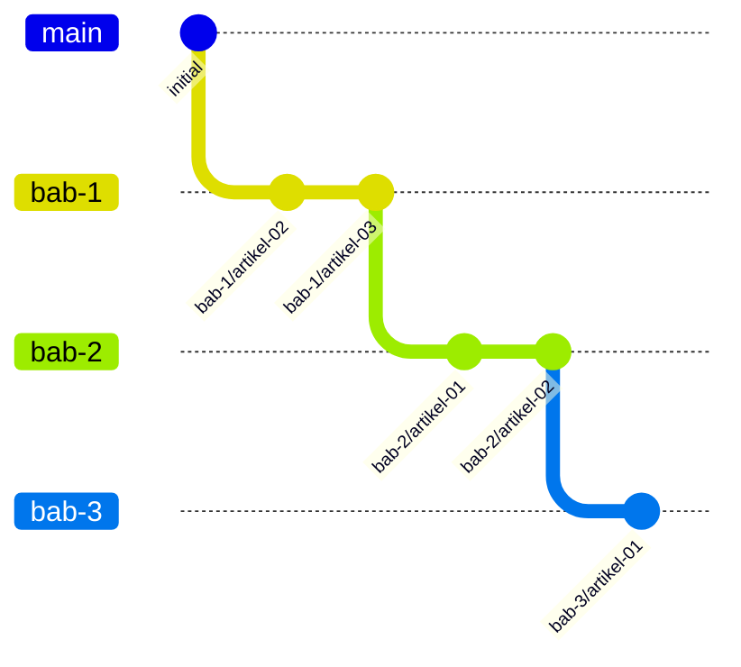

# Contributing

GoShop is the code behind a tutorial course, so the history is part of the product: readers check out a chapter branch, diff two chapters, or look up the commits behind one article. The rules below keep that history readable.

## Branch per chapter

Each chapter ("bab") of the course is one long-lived branch.



- `bab-N` is created from `bab-(N-1)`: `git switch bab-2 && git switch -c bab-3`.
- Branches only move forward. Never rebase or force-push a `bab-N` branch; articles link to them.
- `main` is fast-forwarded to the latest verified chapter, so it always equals some `bab-N`.
- No tags named like the branches (`bab-3`), because `git checkout bab-3` would become ambiguous.

Useful commands for readers:

```bash
git diff bab-4..bab-5                         # everything chapter 5 added
git log --oneline bab-4..bab-5                # the commits of chapter 5
git log --oneline --grep "bab-5/artikel-03"   # the commits behind one article
```

## Commits

Use [Conventional Commits](https://www.conventionalcommits.org/) with the article as the scope:

```
<type>(bab-N/artikel-NN): <what changed, imperative, lower case>
```

| Type | Use for |
|---|---|
| `feat` | new behaviour in an app |
| `fix` | a bug fix |
| `docs` | documentation only (`docs/`, READMEs, ADRs) |
| `build` | Docker, Compose, Makefile, dependencies |
| `chore` | repo housekeeping, tooling config |
| `test` | tests only |
| `refactor` | code change with no behaviour change |

Examples: `feat(bab-3/artikel-04): add sqlc product queries`, `docs(bab-1/artikel-10): add initial ERD`.

One article may have several commits; one commit never mixes two articles. Conceptual articles have no commit.

## Fixing an earlier chapter

When a bug is found in code that was introduced in `bab-K`:

1. Fix it on `bab-K`, the earliest branch that has the bug: `fix(bab-K/artikel-NN): …`.
2. Merge it forward through every later branch, in order, resolving conflicts on each:

   ```bash
   git switch bab-K+1 && git merge --no-ff bab-K
   git switch bab-K+2 && git merge --no-ff bab-K+1
   # … up to the latest bab-N
   ```

3. Rerun the verified gate on every branch the fix touched and update the verified SHA in each `docs/bab-N.md`.
4. Correct the affected article listings in the same PR, then fast-forward `main`.

Merging (not cherry-picking) keeps one commit for the fix, so `git branch --contains <sha>` shows exactly which chapters have it.

## Pull requests

Open the PR from `bab-N` and fill in `.github/pull_request_template.md`. A chapter is mergeable only when all five stages of the verified gate listed in the template pass on the same commit, `make verify` passes locally (the Makefile arrives in Bab 1 artikel-12), and `docs/bab-N.md` is complete.

## Secrets

Never commit real credentials or a `.env` file. Only `.env.example` (arrives in Bab 1 artikel-13), with placeholder values, is tracked. The secret scan in the verified gate (`make scan`, arrives in artikel-12) checks every tracked file and every new file that is not gitignored.
