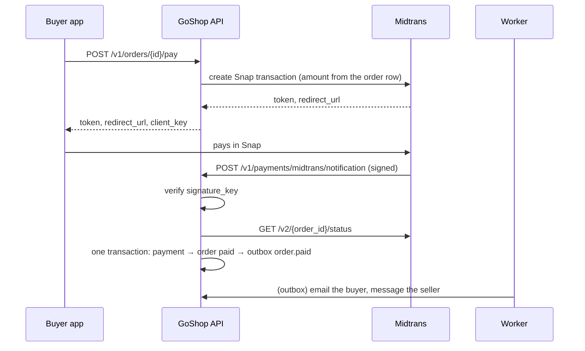
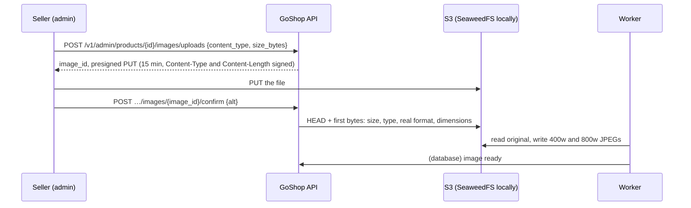

# 0007. Take payments through Midtrans Snap, upload images straight to S3, and run side effects on an Asynq worker

- Status: Accepted
- Date: 2026-10-24
- Chapter: Bab 6

## Context

Bab 5 ends with orders that wait in `pending_payment`, an outbox full of `order.*` events that only reach the log, and products without photos. Bab 6 has to close all three (`docs/prd.md` F8, F9):

- **Money arrives from outside.** A buyer pays in Midtrans (virtual account, QRIS, e-wallets), not in GoShop. GoShop learns about it from an HTTP notification that anyone on the internet can send, may arrive twice, late, out of order, or not at all.
- **The PRD's target is 0 orders paid but not marked paid after 5 minutes**, and an order that was cancelled must never come back to life because a payment arrived for it.
- **Images are big.** A 5 MB photo through the API would hold a request, a connection and memory for every upload; the API only needs to know that the photo exists and is a photo.
- **Emails and chat messages are slow and fail**, and must never make a checkout or a webhook fail. They have to happen after the change commits, and at least once.
- **Bab 5 left four seams** (ADR 0006): the outbox's real publisher with a bounded publish time, deleting published events, cleaning up abandoned guest carts, and `MarkPaid` from the webhook. ADR 0005 left the refresh-token cleanup.
- **The machine budget is small.** One Railway project, a laptop with Docker; Redis is already there (Bab 4).
- **Readers copy the code**, one article at a time.

## Decision

We will take payments with **Midtrans Snap** and trust only a **signed notification confirmed by Midtrans' status API**; let sellers upload photos **directly to S3 with presigned URLs**; and run every side effect (emails, the seller's Telegram message, image resizing, periodic jobs) on a **separate worker process with an Asynq queue on Redis**, fed by the Bab 5 outbox.

### Payment flow

- **`POST /v1/orders/{id}/pay`** (the buyer's own `pending_payment` order) creates a Snap transaction and answers its `token` and `redirect_url`, plus Midtrans' public `client_key` for Snap.js. Nothing in the request body is used: the amount is the order's `total`, read from the row. The call to Midtrans happens **outside any transaction**, through sdk `httpx` with `context.WithoutCancel` and `APP_PAYMENT_TIMEOUT`, the same reason as Biteship in ADR 0006: a buyer hanging up must not count as a Midtrans failure in the circuit breaker.
- **One open payment per order, reused.** A `payments` row is open while its status is `pending` or `challenge`, and the partial unique index `payments (order_id) WHERE status IN ('pending', 'challenge')` allows one. Paying again returns the open payment (200) instead of creating another. Two requests that race both call Midtrans; the second `INSERT … ON CONFLICT DO NOTHING` loses and answers the first one's token. The loser's Snap token is never shown to anyone, and Midtrans creates no transaction until a buyer picks a payment method, so it simply expires.
- **The insert waits for a close in progress.** The insert reads the order `FOR SHARE` (one statement, after the Midtrans call). Every path that closes or pays an order locks the order row first, so the insert queues behind one that is running and then re-checks the status on the committed row (409 `INVALID_TRANSITION` if it is no longer `pending_payment`); and a close that starts after the insert waits for it, then finds the new payment and closes it too. No open payment is left on a closed order, and nothing needs to re-read the order afterwards.
- **A new payment after a closed one.** When the open payment ends without money (`deny`, `cancel`, `failure`), the order stays `pending_payment`, and paying again creates a new payment until the order's deadline. Each payment has its own Midtrans `order_id`, `<order code>-<6 random characters>` (for example `GS-20261101-7KQ2M9-K3D9QX`): Midtrans refuses a used `order_id`, and the order code keeps it readable in the Midtrans dashboard.
- **What the buyer sees** (Bab 11). A denied, cancelled or failed payment leaves the order in `pending_payment`, so the order alone cannot tell the buyer why it still waits. The order (`GET /v1/orders/{id}`, and every answer that returns an `Order`) carries `latest_payment`: the newest payment's `status`, `expires_at` and `updated_at`, or `null` before the first one. Nothing else: no Snap token, no Midtrans IDs, no amount. It is read after the order, which is scoped to its buyer, with `ORDER BY created_at DESC, id DESC LIMIT 1` on the existing `payments_order_created_idx (order_id, created_at DESC)`; no new index. Read after the order, it can be newer than the order's `status`, never older, so the order's `status` decides and `latest_payment` only explains a waiting order. Lists (`OrderSummary`) leave it out: one query per row for a hint the list does not need.
- **Expiry.** The Snap transaction expires one minute before the order's `payment_expires_at`, rounded down to the minute (Snap counts in minutes). Midtrans stops taking money before GoShop's expiry job cancels the order, so a buyer can never pay an order that is about to be cancelled. Fewer than two minutes left is 409 `PAYMENT_WINDOW_CLOSED`.
- **Back to the storefront** (Bab 11). With `APP_WEB_URL` set, every Snap transaction carries `callbacks.finish` = `<APP_WEB_URL>/pembayaran/selesai`, so Midtrans sends the buyer back to the storefront when they finish; without it, the sandbox dashboard's "Finish Redirect URL" must name that page. The URL Midtrans appends `order_id`, `status_code` and `transaction_status` to is only a way home: the page never acts on them and asks the API, the same rule as the notification below. The value must be an `https` origin (`http://localhost` in development), because a buyer is sent there with the payment's identifiers.
- **Sandbox only.** `MIDTRANS_IS_PRODUCTION` must be `false`, and the keys must be sandbox keys (`SB-Mid-server-…`, `SB-Mid-client-…`); anything else stops the API at start. An empty `MIDTRANS_SERVER_KEY` turns payments off: both payment routes answer 503 `PAYMENTS_DISABLED`, logged at WARN, not ERROR, because the configuration chose it (the same for 503 `STORAGE_DISABLED` without `S3_ENDPOINT`).

### Notification: verify, then ask Midtrans

`POST /v1/payments/midtrans/notification` is public (Midtrans calls it), so it trusts nothing it is sent:

1. **Bounded.** The body is read through a 64 KiB limit, and each client IP may call it `120` times a minute (429 otherwise).
2. **Signed.** `signature_key` must equal `SHA-512(order_id + status_code + gross_amount + server_key)` in hex, compared with `hashx.ConstantTimeEqual`. A wrong one is 403 `INVALID_SIGNATURE`. Only a holder of the server key can produce it.
3. **Confirmed.** The API then asks Midtrans' status API (`GET /v2/{order_id}/status`) and acts on **that** answer, never on the notification's fields, and checks the status answer's signature too. A replayed old notification, or one that arrives out of order (`pending` after `settlement`), only makes GoShop read the current status again, so every path converges on the truth. The cost is one HTTP call per notification; a few per order.
4. **The amount must match.** The status answer's `gross_amount` must equal the payment's `amount` (the order's `total`). A mismatch changes nothing, is recorded, and is logged at ERROR.
5. **Unknown `order_id`** with a valid signature is 404: nothing to record it against.

The webhook and the reconciler (below) share one function, `payment.Service.Apply`, which runs **one transaction**:

| Midtrans says | Payment becomes | Order |
|---|---|---|
| `settlement`, or `capture` with `fraud_status` `accept` | `paid` | `pending_payment → paid` (`MarkPaid`, the `order.paid` outbox event) |
| `capture` with `challenge` | `challenge` | unchanged: a human at Midtrans decides |
| `pending` | `pending` | unchanged |
| `deny`, `cancel`, `failure` | `denied`, `cancelled`, `failed` | unchanged: the buyer may pay again until the deadline |
| `settlement` for a payment GoShop closed (`cancelled`, `expired`) | `paid` | unchanged; the payment is flagged `refund_required` |
| `expire` | `expired` | `pending_payment → cancelled` with `payment_expired`, stock and voucher back (the expiry path of ADR 0006) |
| `refund`, `partial_refund`, `chargeback`, `partial_chargeback` | `refunded`, `partially_refunded` | unchanged (refunds are the chapter's challenge) |

- **Never backwards.** Payment statuses have their own table of allowed moves (`pending → paid`, never `paid → pending`), enforced the same way as orders: Go table plus a guarded `UPDATE … WHERE status = ANY(@from)`. The order moves only through ADR 0006's guarded transitions, which start from `pending_payment` only. No notification can move an order out of `paid`, `shipped` or `completed`.
- **Idempotent and replay-safe.** Every status that is acted on is recorded in **`payment_events`**, keyed by `(payment_id, dedupe_key)` where the key is Midtrans' `transaction_id`, `transaction_status` and `fraud_status`. A duplicate inserts nothing and changes nothing, so Midtrans may retry as often as it likes. The table is also the audit trail: source (`webhook` or `reconcile`), the raw status, the amount, and what GoShop did (`outcome`).
- **A payment for an order that can no longer be paid** (it expired, was cancelled, or another payment already paid it) **never resurrects the order**: the payment becomes `paid`, `refund_required_at` is set, the outcome is `refund_required`, and a WARN is logged. Refunding is the seller's job (the chapter's challenge, below).
- **Closing an order closes its open payment.** Cancelling an order (the buyer, the seller, the expiry job, an account deletion) marks its open payment `cancelled` in the same transaction, so the order's Snap page is no longer GoShop's open payment. GoShop does not call Midtrans' cancel API: Midtrans still expires the transaction itself a minute before the order's deadline at the latest, and calling it would belong in the worker through the outbox, never inside the transaction. A buyer who pays the cancelled transaction anyway is recorded (`cancelled → paid` and `expired → paid` are allowed moves: money that arrived is never ignored) and flagged for a refund.

### Lock order

ADR 0006's table gains the payment paths. **The order comes before its payments, everywhere**; no path takes them the other way round, and none holds a lock while it calls Midtrans:

| Path | Order |
|---|---|
| pay | read the order (no lock) → Midtrans (no transaction) → insert the payment, reading the order `FOR SHARE` in the same statement |
| notification, reconcile: paid | the order (`FOR NO KEY UPDATE`) → the payment row (guarded `UPDATE`) → the order's guarded `UPDATE` → outbox event → payment event |
| notification, reconcile: expired | the order → the payment row → the order's guarded `UPDATE` → its variants (id order) → voucher → outbox event → payment event |
| notification, everything else | the order → the payment row → payment event |
| cancel, expiry (ADR 0006) | the order (its guarded `UPDATE`) → its variants (id order) → voucher → its open payment → outbox event |
| account deletion (ADR 0006) | … → the order cancels and events → all their open payments (one statement) → cart → idempotency keys |

Why the notification locks the order first: closing an order now writes its payment, after the order row. A notification that took the payment row first and then waited for the order, while a cancel held the order and waited for the payment, would deadlock. With the order first on both sides, the second one simply waits. The order lock is `FOR NO KEY UPDATE`, the strength of the order's own status `UPDATE`s. The notification never touches `users`, so the users-first rule of ADR 0005 is not involved; account deletion (`users → orders → … → payments`) and a notification meet on the order row first, in the same order.

### Reconciliation

A notification can be lost (GoShop down for longer than Midtrans retries). `api reconcile-payments`, and the worker every 5 minutes, ask the status API about payments older than a minute, the least recently checked first (`payments.checked_at`), 100 per run, and apply the answer with the same `Apply` as the webhook. Two queues feed it, each with its own partial index and its own LIMIT, merged by `checked_at`:

- **open payments** (`pending`, `challenge`; `payments_reconcile_idx`);
- **payments GoShop closed itself** when their order closed (`cancelled`; `payments_closed_window_idx`). Midtrans was never told about the close, so it takes money until `expires_at`; a settlement found there becomes `paid` and `refund_required`, exactly as when the notification arrives. Without this queue, money paid on a cancelled order's Snap page while the notification was lost would never be recorded.

A transaction Midtrans does not know (404: the buyer never chose a method) past its expiry is closed as `expired` (an open payment) or left as it is (a closed one). Every checked payment moves to the back of its queue.

**A closed payment leaves the queue only when a check gets a final answer**: settled (or a card capture the fraud check accepted), expired, denied, cancelled, failed, refunded, or no such transaction after its expiry (`payment.Final`). That answer sets `payments.final_checked_at`. Not after a fixed time, and not after any check past its window: a backlog could push a payment past its window unchecked, and Midtrans' own expiry can lag, so a check just after the window may still answer `pending`; either way a settlement that came later, with its notification lost, would never be recorded. With this rule a backlog is delayed, never dropped, and "money that arrives is never lost" holds however many orders are cancelled and however late Midtrans expires them. The partial index `payments_closed_window_idx (expires_at) WHERE status = 'cancelled' AND final_checked_at IS NULL` holds exactly the closed payments still without a final answer, so it stays as small as that backlog, and the years of finished closed payments are never read. Every check that gets an answer, final or not, sets `checked_at`. An answer whose amount does not match the payment changes nothing, so it is not final either; and closing an order resets its payment's `final_checked_at`, because the close starts a new window to watch, whatever the reconciler concluded while the payment was open.

Four rules keep the two queues fair to each other and to the money:

- **Each queue has its own budget per run**: up to 100 open payments and up to 25 closed ones (a quarter more), so a long queue of open payments never stops the closed ones being asked about, and a backlog of closed ones never takes an open payment's place.
- **Open payments come first** when the two are merged (an output column `closed`, false before true; a UNION can only be ordered by its output columns). Ordering by `checked_at NULLS FIRST` with one shared LIMIT put every closed payment that had never been checked ahead of open payments checked once already: in the database audit, a backlog of 2,000 closed payments made 50 open payments wait about 109 minutes for their next check, against about 9 without it. With separate budgets the same backlog leaves them at 9 minutes.
- **Closed payments closest to the end of their window go first** (`ORDER BY expires_at`), so the ones about to stop taking money are asked about before the ones that will take it for hours.
- **A closed payment is asked about at most every 30 minutes**, with one exception: once its window has ended (10 minutes after `expires_at`) and it has not been checked since, it is due at once. A payment that still gets no final answer after that goes back to the 30-minute spacing, for as long as it takes.

**Capacity.** 25 closed checks per run, every 5 minutes, is 300 an hour. Above that rate the checks, the final ones included, are delayed, never dropped: a settlement on a closed payment is recorded late (with its refund flag) but recorded. Raising `closedShare` drains faster at the cost of more Midtrans calls per run.

**A check that fails** (Midtrans down, a timeout, an answer that does not verify) changes nothing, not even `checked_at`, so the payment keeps its place at the head of its queue and is asked about again in the next run. That is right for an outage: nothing is skipped, and everything is asked again when Midtrans is back. The trade-off is a payment whose check fails for good (an answer Midtrans keeps refusing to sign, say): it takes one of the 25 closed slots in every run until an operator looks at the WARN line the reconciler logs for it each run. Skipping it after N failures would free the slot, but it would also be the one way a payment could leave the queue without a final answer.

### Image uploads: presigned PUT, then confirm

- The API **never receives the file**. It signs a `PUT` for the key `uploads/<product id>/<image id>/original`, valid 15 minutes, with `Content-Type` and `Content-Length` among the signed headers, so the upload must be exactly the type and size that were declared: `image/jpeg`, `image/png` or `image/webp`, at most 5 MiB. A `product_images` row in `pending_upload` holds what was declared; at most 10 images per product, pending ones included.
- **Confirm checks what arrived**, because a presigned URL is a promise about the request, not about the bytes: the object's size and type must match the row, the first bytes must really be that format (`http.DetectContentType`), and the dimensions must be at most 6000 px a side and 24 megapixels, so a small file that decodes into a huge bitmap is refused before anything decodes it. Anything else deletes the object and the row (422 `UPLOAD_INVALID`).
- **The worker makes the images the storefront shows**: 400 and 800 pixels wide, JPEG quality 82, resized with `golang.org/x/image/draw` (Catmull-Rom), under `products/<product id>/<image id>/<width>.jpg`. Re-encoding also drops the original's metadata (a phone photo's GPS position). The storefront lists **ready images only**, with a `variants` list for `srcset`; the original is never linked.
- **Turned the way the photo was taken.** Phones store a photo as the sensor saw it and write how to turn it in the EXIF Orientation tag; browsers turn the original, but the re-encoded variants have no EXIF. The worker reads the tag from the JPEG's APP1 segment (a few bounds-checked lookups, no library: the rest of EXIF is not needed) and turns each variant after scaling it, so the turn runs on the small image. The variant's `width` is the displayed width.
- **Private originals, public variants.** The bucket is private; only `products/*` is publicly readable. Originals (the seller's file, with its metadata, and not even known to be an image until confirm) stay under `uploads/`. The local SeaweedFS has the same rule (`deploy/seaweedfs/s3.json`: anonymous `Read:goshop/products/*`); in production a bucket policy, or a CDN or R2 custom domain in front of `products/`, does it.
- **SeaweedFS locally** (ADR 0003), any S3-compatible bucket in production, through **`github.com/minio/minio-go/v7`** behind sdk `storagex.Storage` plus a presign method. `api migrate` creates the bucket when it is missing, so `make up` needs no manual step.

### The worker

- **A second binary, `apps/api/cmd/worker`**, built from the same module by `apps/api/Dockerfile.worker` and deployed as its own Railway service (`deploy/railway/worker.json`). It shares the domain packages, the configuration and the database with the API, but serves no public HTTP: only `/healthz` and `/readyz` on `$PORT` for the platform.
- **Asynq** (`github.com/hibiken/asynq`) on the Redis GoShop already runs: a task queue with retries, backoff, a dead-letter ("archived") queue, unique tasks and a cron-style scheduler, in one library.
- **Scheduled jobs** move onto Asynq's scheduler, each enqueued as a unique task so two worker instances do not run the same tick twice: publish the outbox (every 5 s), expire orders (1 min), reconcile payments (5 min), process uploaded images (30 s), delete expired idempotency keys and expired refresh tokens (hourly), delete abandoned guest carts (hourly; a guest cart untouched for 30 days), delete published outbox events and their delivery records (daily, after 7 days). Every job was already safe to run twice at once (guarded `UPDATE`s, `SKIP LOCKED`). The one-shot `api …` commands stay for operators. With several worker instances, each runs a scheduler and the losing enqueues are refused as duplicates; the worker logs those at DEBUG and any other enqueue failure (Redis down: the tick's job did not run) at ERROR.
- **A guest cart's last use is its `updated_at`.** Every write to a guest cart's lines touches the cart row (`LockGuestCart` is an `UPDATE`, not a `SELECT … FOR UPDATE`). The cleanup deletes carts not touched for 30 days with `FOR UPDATE SKIP LOCKED`; PostgreSQL re-checks a row against the `WHERE` only when the row changed while the cleanup waited for it, so a write that merely locked the cart would have lost its new line with the cart.
- **Retries and the dead-letter queue.** Every task type has a retry limit (emails 8, the Telegram message 5, jobs 3) and an exponential backoff (10 s doubling, at most 1 hour, with jitter). A task that runs out of retries is archived by Asynq, and stays there for an operator: `worker dead-tasks list`, `worker dead-tasks requeue <id>`, `worker dead-tasks requeue-all`. A permanent error (the order no longer exists) skips the retries.

### The outbox publisher

- **One task per consumer per event.** `outbox.QueuePublisher` turns `order.created` into the order-confirmation email, `order.paid` into the payment-received email and the seller's Telegram message, `order.shipped` into the shipped email. Each consumer retries on its own: a failing Telegram does not send the email twice.
- **Bounded publish time.** The dispatcher still claims a batch with `FOR UPDATE SKIP LOCKED` inside a transaction, so its locks are held while it enqueues. Each enqueue gets a 2-second timeout; the first one that fails or times out ends the batch, so a hanging Redis holds the batch's locks for one timeout at most. All the enqueues of one batch together get 5 seconds, so a slow (not hanging) Redis cannot hold them for 100 × 2 seconds either: the events published so far are marked and the rest wait for the next tick. A run takes at most 10 batches of 100.
- **At least once, so idempotent consumers.** Each task's Asynq `TaskID` is `<event id>:<consumer>`: an event published twice (the process died between the enqueue and the commit) is refused by Asynq as a duplicate. Each consumer also records `(event id, consumer)` in **`event_deliveries`** after its side effect and skips an event it has already delivered, which holds even after Asynq has forgotten the task. A crash between the side effect and that record sends one duplicate email: at least once, never lost.
- **"Never lost" has one boundary**: an event is marked published once its tasks are in Redis. From then on the tasks are as durable as Redis is, so production Redis must keep `maxmemory-policy noeviction` (Railway's default) and persistence on. The rate-limit and session keys of ADR 0005 all have TTLs and never needed eviction.

### Email and Telegram

- **SMTP** (`net/smtp`, STARTTLS required except to `localhost`) when `SMTP_HOST` is set; otherwise the Bab 4 log mailer. Locally the log mailer stays the default; [Mailpit](https://mailpit.axllent.org) works as an SMTP server for anyone who wants to see the emails (`docs/configuration.md`).
- With SMTP on, the API's own emails (verify, reset) are **queued to the worker** too, so a request no longer waits for the mail server and forgot-password takes the same time whether the account exists or not (SECURITY.md, API2).
- Templates are plain text (`text/template`) with the order code, totals and a link to nothing secret; message bodies are never logged outside development.
- The seller's **Telegram** message uses sdk `messagingx` when `TELEGRAM_BOT_TOKEN` and `TELEGRAM_CHAT_ID` are set; neither set turns it off. WhatsApp has no provider in the sdk (`docs/sdk-gaps.md`).

### Testing without Midtrans

`APP_PAYMENT_PROVIDER=fake` swaps Midtrans for `internal/payment/fake`: the same interface, transactions kept in Redis, its own signing key. `api fake-pay <order code> [settlement|expire|deny|…]` sets a transaction's status and sends a signed notification to the API, so a developer can pay an order on `make up` with no account anywhere. The API refuses to start with the fake in production.

### Sales report

`GET /v1/admin/reports/sales?from&to&group=day|week|month` (staff only): revenue, order count and average order value per period with a running total (window function), and the top products, from orders paid in the range that were not cancelled afterwards. Days are Jakarta days. A partial index on `orders (paid_at) WHERE status IN ('paid', 'processing', 'shipped', 'completed')` serves the range.

### Designed for refunds (the chapter's challenge)

Partial refunds are left to the reader, but the data has room for them: `payments.refunded_amount` (0 up to `amount`), the `refunded` and `partially_refunded` payment statuses that Midtrans' refund notifications already map to, and `refund_required_at` for the late payments that must be returned. A refund is a new `refunds` table (amount, reason, Midtrans refund key) plus one call to Midtrans' refund API; nothing existing has to change shape.

## Alternatives considered

- **Midtrans Core API instead of Snap** — GoShop would build every payment method's screen itself. Snap is Midtrans' hosted page for the web and both mobile platforms.
- **Trusting the notification body once its signature checks** — one call fewer, but a replayed `pending` after a `settlement` would need ordering logic; asking for the current status makes every notification only a hint and every path converge.
- **One Midtrans transaction per order, `order_id` = order code** — simpler, but a denied card or a cancelled virtual account would end the order's chance to be paid, and Midtrans refuses a used `order_id`.
- **Holding the order's row lock while calling Midtrans** — would serialise two pay requests, but ten slow Midtrans calls would hold ten pool connections and stall the API (the Bab 5 Biteship lesson).
- **Uploading through the API** (multipart) — the API would stream every byte and need the memory and time for it; presigned URLs are what S3 is for.
- **A presigned POST policy** (`content-length-range`) — enforces a size range at S3, but is a form upload that mobile clients handle worse than a plain `PUT`, and not every S3-compatible store supports it the same way. The signed `Content-Length`, checked again at confirm, gives the same guarantee.
- **WebP variants** — smaller files, but no pure-Go encoder exists in `golang.org/x/image`, and cgo (`libwebp`) would end the static, distroless image. JPEG is understood everywhere.
- **aws-sdk-go-v2** — the official client, but a dozen modules and more configuration for a custom endpoint; minio-go is one module, made for S3-compatible servers, and has presigned headers built in.
- **A queue in PostgreSQL** (`SKIP LOCKED` jobs, River) — no Redis dependency for jobs, but GoShop already runs Redis, and Asynq gives retries, a dead-letter queue, unique tasks and a scheduler without writing them.
- **Running the jobs on goroutines inside the API** — no new service, but every API instance would run every job, a deploy would cut a job off, and a slow email would compete with requests for the same CPU.
- **Mailpit in Docker Compose** — nice to look at, but one more container on a laptop for something the log mailer shows already; it stays optional.

## Consequences

- One more deployable service (the worker) with its own Dockerfile, Railway config and health checks. It reads the same variables as the API, secrets included (`JWT_SECRET` stays required, because both binaries validate one configuration).
- Paying needs Midtrans reachable; a Midtrans outage is 503 `UPSTREAM_UNAVAILABLE` on pay and on notifications (Midtrans retries those), and the reconciler catches up afterwards.
- Every notification costs one status call to Midtrans.
- Redis is now a durability boundary for side effects: it must not evict, and it should persist.
- A buyer may end up with two Snap tokens after a double tap; only one is ever recorded, the other expires unused.
- Images are visible on the storefront only after the worker has processed them (normally within 30 seconds of confirm), and only as JPEG.
- Uploads that are signed but never confirmed leave an object behind; the hourly cleanup deletes `pending_upload` rows older than a day and their objects.
- New tables: `payments`, `payment_events`, `product_images`, `event_deliveries`; new indexes for the reconciler, the guest-cart and refresh-token cleanups, the outbox cleanup and the sales report.
- The refresh-token index is built **without** `CONCURRENTLY`, unlike what ADR 0005 asked: golang-migrate holds a session advisory lock while it migrates, a second `api migrate` waits for it inside a statement, and `CREATE INDEX CONCURRENTLY` waits for that statement in turn, a deadlock PostgreSQL resolves by failing the second deploy. Nothing is deployed before Bab 19, so the table is small; the migration says how to build the index by hand on a big table first.
- New direct dependencies: `github.com/hibiken/asynq`, `github.com/minio/minio-go/v7`, `golang.org/x/image`.
