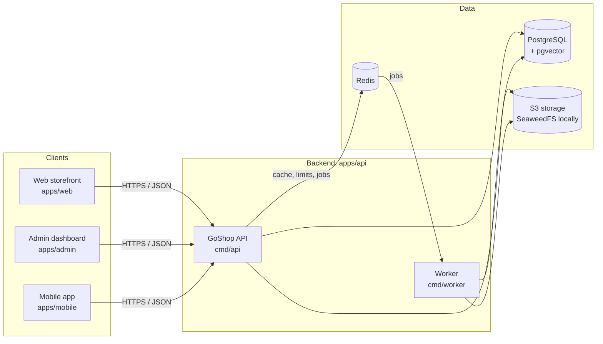
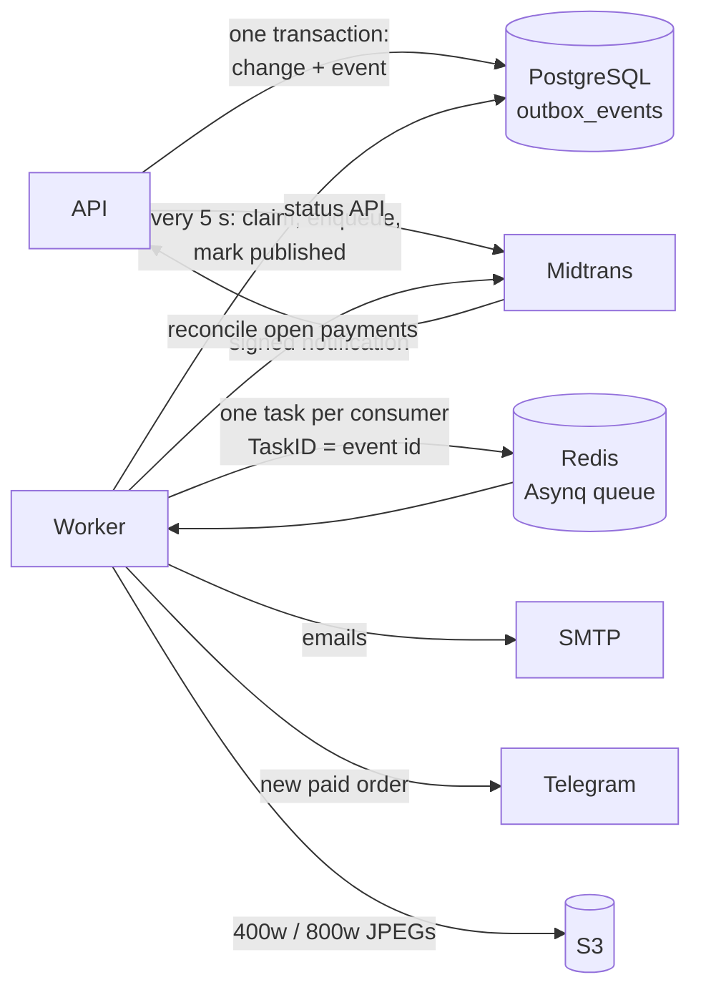

# Architecture

GoShop has three clients and one backend. The web storefront, the admin dashboard and the mobile app all talk to the same Go API over HTTPS and JSON. Only the API (and its background worker) touches the database, the cache and the object storage.

## Components

| Component | Path | Responsibility | Arrives in |
|---|---|---|---|
| GoShop API | `apps/api/cmd/api` | REST API under `/v1`, auth, business rules; the API and the worker are the only writers to the database | Bab 2 |
| Worker | `apps/api/cmd/worker` | Asynq tasks from Redis ([ADR 0007](adr/0007-payments-uploads-worker.md)): the outbox's events as emails and the seller's Telegram message, image resizing, payment reconciliation, order expiry and the cleanups; serves only `/healthz` and `/readyz` | Bab 6 |
| Web storefront | `apps/web` | Catalog, cart, checkout for buyers in the browser | Bab 7 |
| Admin dashboard | `apps/admin` | Products, stock and orders for sellers and admins | Bab 12 |
| Mobile app | `apps/mobile` | The storefront on Android and iOS | Bab 13 |
| PostgreSQL + pgvector | `docker-compose.yml` (`postgres`) | System of record; pgvector stores embeddings for semantic search (Bab 18) | Bab 1 (compose), Bab 3 (schema) |
| Redis | `docker-compose.yml` (`redis`) | Rate limits and revoked-session markers (Bab 4; refresh tokens stay in PostgreSQL, [ADR 0005](adr/0005-auth-tokens.md)); from Bab 6 the worker's Asynq queue, so production Redis must not evict keys (`maxmemory-policy noeviction`) and should persist; from Bab 12 the pub/sub channel of the admin's live feed, one connection per open stream | Bab 1 (compose), Bab 4 (used) |
| S3 storage | `docker-compose.yml` (`storage`) | Product and review images, uploaded by clients with presigned URLs and resized by the worker; SeaweedFS S3 gateway locally, any S3-compatible bucket in production | Bab 1 (compose), Bab 6 (used) |
| Midtrans | external | Snap payment pages and the payment notifications (sandbox only); `internal/payment/fake` stands in for it locally | Bab 6 |

The API and the worker are two binaries built from the same Go module, so they share the domain code and are deployed as two services.

## Background work (Bab 6)

- The API never sends an email or a message in a request that changes an order: the change writes an event to the outbox in its transaction, and the worker turns it into tasks. An event exists exactly when its change committed; delivery is at least once, and every consumer skips an event it has handled (`event_deliveries`).
- The worker also runs the scheduled jobs on Asynq's scheduler (order expiry, payment reconciliation, image processing, cleanups); each is also an `api` command for operators.
- Failing tasks retry with backoff and then wait in Asynq's archived (dead-letter) queue for `worker dead-tasks requeue`.
- From Bab 12 the dispatcher also publishes every order event to the Redis pub/sub channel `goshop:admin:events`, after the tasks. Each admin dashboard holds a Server-Sent Events stream (`GET /v1/admin/events`) on whichever API instance it reached, and that stream subscribes to the channel: a live feed, at least once and without replay ([ADR 0009](adr/0009-admin-live-events-sse.md)).

## Why one API

- **One set of rules.** Prices, stock, order status and permissions are checked in exactly one place. A web-only or mobile-only backend would sooner or later disagree with the other one.
- **One contract.** `api/openapi.yaml` describes every endpoint once. The web, admin and mobile clients are all generated or typed from it, so a change is visible to every client at the same time.
- **Clients differ by role, not by backend.** The admin dashboard uses the same API as the storefront; admin-only endpoints are protected by the caller's role, not by a separate service.
- **Small enough to run anywhere.** One API, one worker and three managed dependencies fit on a laptop with `make up` and on a small Railway project in production.

When a client needs a different shape of data (for example a server-rendered storefront page in Bab 11), the API gets a new endpoint instead of the client getting its own backend.
