# Initial data model (ERD)

This is the logical model for the first GoShop features: users, the catalog, carts and orders. It is a design, not a schema: the physical tables, indexes and migrations are written in **Bab 3** onwards, and later chapters add tables (payments, reviews, embeddings) next to these. Bab 5's design decisions (carts, checkout, vouchers, idempotency, the outbox) are [ADR 0006](adr/0006-cart-checkout-orders.md).

Every column is `NOT NULL` unless the diagram says `nullable`.

## Built so far

| Chapter | Migration | Tables |
|---|---|---|
| Bab 3 | `apps/api/migrations/000001_create_catalog` | `categories`, `products`, `product_variants`, with every constraint and index below that belongs to them |
| Bab 4 | `000002_create_users` | `users`: the email lower-case CHECK (ASCII only, enforced by the API), the role CHECK (`buyer`, `seller`, `admin`), and a CHECK that an anonymised row keeps no password, phone or name |
| Bab 4 | `000003_create_refresh_tokens` | `refresh_tokens` ([ADR 0005](adr/0005-auth-tokens.md)): SHA-256 of the secret only, `family_id` = the session, `used_at` for rotation and reuse detection, `revoked_at`; indexes on `family_id` and on `user_id` for the tokens that can still be used |
| Bab 4 | `000004_create_user_tokens` | `user_tokens`: one-time email tokens (`verify_email`, `reset_password`), SHA-256 of the secret only, `used_at`, `expires_at`; an index on `(user_id, purpose)`, not partial, so it also serves deleting a user's tokens and the CASCADE |
| Bab 4 | `000005_create_user_identities` | `user_identities`: `UNIQUE (provider, subject)` (the sign-in lookup) and `UNIQUE (user_id, provider)`; provider CHECK (`google`) |
| Bab 4 | `000006_create_addresses` | `addresses`: postal-code CHECK, `addresses (user_id)`, and the partial unique index `addresses (user_id) WHERE is_default` (at most one default; the API keeps exactly one while the user has any) |
| Bab 5 | `000007_create_carts` | `carts` (one per user, `carts_user_key`; a guest cart has `token_hash` instead, `carts_owner_check`) and `cart_items` (primary key `(cart_id, variant_id)`, quantity 1–99, the price the buyer saw, `cart_items_variant_id_idx` for the RESTRICT) |
| Bab 5 | `000008_create_vouchers` | `vouchers`: `vouchers_code_key`, kind/value/window/limit CHECKs, and `vouchers_used_count_check` (the counter never passes its limit) |
| Bab 5 | `000009_create_orders` | `orders` and `order_items` as below, with `discount`, `voucher_id` and `voucher_code` added in Bab 5 (`orders_amounts_check`: `total = subtotal - discount + shipping_fee`); `orders_paid_check` (every status from `paid` on has `paid_at`); indexes `orders_user_created_idx`, `orders_user_pending_idx` (partial, `pending_payment`), `orders_status_created_idx`, `orders_payment_expires_idx` (partial, `pending_payment`), `orders_voucher_user_idx` (partial) and `order_items_variant_id_idx` |
| Bab 5 | `000010_create_idempotency_keys` | `idempotency_keys`: primary key `(user_id, key)`, the SHA-256 of the body, a `claim_id` that saving and releasing must match, the stored answer (`json`, so a replay is byte for byte) and `order_id` (no foreign key: short-lived request state); `idempotency_keys_expires_at_idx` for the cleanup |
| Bab 5 | `000011_create_outbox_events` | `outbox_events` (ADR 0006): one row per order status change, written in the change's transaction; `aggregate_type` and `event_type` CHECKs; the partial `outbox_events_unpublished_idx (created_at, id) WHERE published_at IS NULL` for the dispatcher |
| Bab 6 | `000012_create_payments` | `payments` ([ADR 0007](adr/0007-payments-uploads-worker.md)): one row per Midtrans transaction, `provider_order_id` unique (`<order code>-<6 characters>`), the amount from the order, status CHECK, `paid_at` for every paid status, `refund_required_at` and `refunded_amount` (0 up to `amount`) for refunds; `payments_order_open_key`, a partial unique index that allows one open (`pending`, `challenge`) payment per order; `payments_order_created_idx` |
| Bab 6 | `000013_create_payment_events` | `payment_events`: every distinct status Midtrans reported and what GoShop did (`outcome`); `payment_events_dedupe_key UNIQUE (payment_id, dedupe_key)` turns a repeated notification into a no-op |
| Bab 6 | `000014_add_payments_checked_at` | `payments.checked_at` (the last check that got an answer) and `payments.final_checked_at` (the first check that got a final one), and the reconciler's two queues: the partial `payments_reconcile_idx (checked_at NULLS FIRST, created_at)` over open payments, and the partial `payments_closed_window_idx (expires_at) WHERE status = 'cancelled' AND final_checked_at IS NULL` over payments GoShop closed that have no final answer from Midtrans yet |
| Bab 6 | `000015_create_product_images` | `product_images`: a pending upload until confirmed, content type, size (≤ 5 MiB) and dimension CHECKs, `original_key` unique; `product_images_product_idx (product_id, position, id)`, `product_images_pending_idx` (partial, for the cleanup) |
| Bab 6 | `000016_add_product_image_variants` | `product_images.variants` (jsonb array of `{width, height, key}`), statuses `processing` and `failed`, a ready image has variants; `product_images_processing_idx` (partial) for the worker |
| Bab 6 | `000017_index_guest_carts` | `carts_guest_updated_idx (updated_at) WHERE user_id IS NULL`, for the guest-cart cleanup |
| Bab 6 | `000018_index_refresh_tokens_expires_at` | `refresh_tokens_expires_at_idx`, built `CONCURRENTLY` (ADR 0005), for the expired-token cleanup |
| Bab 6 | `000019_create_event_deliveries` | `event_deliveries (event_id, consumer)`: which consumer handled which outbox event; `outbox_events_published_idx` (partial) for deleting published events after 7 days |
| Bab 6 | `000020_index_orders_paid_at` | `orders_paid_at_idx (paid_at) INCLUDE (id, total) WHERE status IN ('paid', 'processing', 'shipped', 'completed')`, for the sales report |

Two choices made while building it:

- **Timestamps are set by the queries, not by triggers.** `created_at` comes from the column default; every `UPDATE` in `apps/api/internal/db/queries` writes `updated_at = now()`. A trigger would also catch hand-written SQL, but it hides the rule from someone reading the query, and the API is the only writer. `now()` is the transaction's start time, so everything one transaction writes carries the same timestamp.
- **Soft delete only.** `DELETE /v1/admin/products/{id}` sets `status = 'archived'`; a variant left out of `PUT /v1/admin/products/{id}` gets `archived_at`. The API has no SQL `DELETE` for the catalog. Because a save always carries at least one variant, the "last sellable variant" case in the catalog rules below cannot happen through the API yet.

Bab 5 adds the cart and order tables (below); each migration is listed here when it lands. Constraints that the API maps to an error have explicit names (`products_slug_key`, `product_variants_sku_key`, …), so the code matches on a stable name rather than on Postgres's generated one.

```mermaid
erDiagram
    users ||--o{ addresses : "has"
    users ||--o{ orders : "places"
    categories |o--o{ categories : "parent of"
    categories ||--o{ products : "groups"
    products ||--|{ product_variants : "sold as"
    orders ||--|{ order_items : "contains"
    product_variants ||--o{ order_items : "ordered as"
    users |o--o| carts : "owns (or a guest token)"
    carts ||--o{ cart_items : "holds"
    product_variants ||--o{ cart_items : "added as"
    vouchers |o--o{ orders : "applied to"
    users ||--o{ idempotency_keys : "sends"
    orders ||--o{ outbox_events : "announces"
    orders ||--o{ payments : "paid with"
    payments ||--o{ payment_events : "reported as"
    products ||--o{ product_images : "shown in"
    outbox_events ||--o{ event_deliveries : "handled by (no FK)"

    users {
        uuid id PK "UUIDv7"
        text email UK "lower-case only"
        text password_hash "nullable, Google-only accounts"
        text name
        text phone "nullable"
        text role "buyer, seller, admin"
        timestamptz email_verified_at "nullable"
        timestamptz anonymized_at "nullable, set when anonymised"
        timestamptz created_at
        timestamptz updated_at
    }

    addresses {
        uuid id PK
        uuid user_id FK
        text label "Rumah, Kantor"
        text recipient_name
        text phone
        text street
        text city
        text province
        text postal_code
        boolean is_default "at most one per user"
        timestamptz created_at
        timestamptz updated_at
    }

    categories {
        uuid id PK
        uuid parent_id FK "nullable, null = top level"
        smallint level "1 or 2"
        smallint parent_level FK "nullable, always 1"
        text name
        text slug UK "max 100 chars"
        timestamptz created_at
        timestamptz updated_at
    }

    products {
        uuid id PK
        uuid category_id FK
        text name
        text slug UK "max 200 chars"
        text description "default empty"
        text status "draft, active, archived"
        bigint price_from "nullable, cheapest sellable variant"
        tsvector search "generated, full-text"
        timestamptz created_at
        timestamptz updated_at
    }

    product_variants {
        uuid id PK
        uuid product_id FK
        text sku UK "upper-case, trimmed, not empty"
        text name "e.g. Hitam / L"
        bigint price "rupiah, above 0"
        integer stock "0 or more"
        integer version "optimistic lock, default 0"
        integer weight_grams "above 0"
        smallint position "order among equal prices, 0 first"
        timestamptz archived_at "nullable, null = sellable"
        timestamptz created_at
        timestamptz updated_at
    }

    orders {
        uuid id PK
        text code UK "GS-YYYYMMDD-XXXXXX"
        uuid user_id FK
        text status "see life cycle below"
        text cancel_reason "nullable, set when cancelled"
        bigint subtotal "rupiah"
        bigint discount "rupiah, 0 without a voucher"
        bigint shipping_fee "rupiah"
        bigint total "subtotal - discount + shipping_fee"
        uuid voucher_id FK "nullable"
        text voucher_code "nullable, snapshot"
        integer total_weight_grams "above 0"
        text courier "jne, jnt, sicepat"
        text courier_service "e.g. REG, YES"
        text tracking_number "nullable, airway bill"
        text shipping_recipient "address snapshot"
        text shipping_phone "address snapshot"
        text shipping_street "address snapshot"
        text shipping_city "address snapshot"
        text shipping_province "address snapshot"
        text shipping_postal_code "address snapshot"
        timestamptz payment_expires_at
        timestamptz paid_at "nullable"
        timestamptz shipped_at "nullable"
        timestamptz completed_at "nullable"
        timestamptz cancelled_at "nullable"
        timestamptz created_at
        timestamptz updated_at
    }

    order_items {
        uuid id PK
        uuid order_id FK
        uuid variant_id FK
        text product_name "snapshot"
        text variant_name "snapshot"
        text sku "snapshot"
        bigint unit_price "rupiah, snapshot"
        integer quantity "above 0"
        bigint line_total "unit_price x quantity"
        timestamptz created_at
    }

    carts {
        uuid id PK
        uuid user_id FK,UK "nullable, set for a user's cart"
        bytea token_hash "nullable, SHA-256 of a guest cart token"
        timestamptz created_at
        timestamptz updated_at
    }

    cart_items {
        uuid cart_id PK,FK
        uuid variant_id PK,FK
        integer quantity "1 to 99"
        bigint unit_price "rupiah, the price the buyer saw"
        timestamptz created_at
        timestamptz updated_at
    }

    vouchers {
        uuid id PK
        text code UK "upper-case, e.g. HEMAT10"
        text kind "percent, fixed"
        bigint value "percent 1-100, or rupiah"
        bigint min_spend "rupiah, 0 = none"
        bigint max_discount "nullable, rupiah cap"
        timestamptz starts_at
        timestamptz ends_at
        integer usage_limit "nullable = unlimited"
        integer used_count "guarded increment"
        integer per_user_limit "default 1"
        timestamptz created_at
        timestamptz updated_at
    }

    idempotency_keys {
        uuid user_id PK,FK
        text key PK "Idempotency-Key header"
        bytea request_hash "SHA-256 of the body"
        uuid claim_id "new on every claim; save and release match it"
        smallint response_status "nullable while in flight"
        json response_body "nullable while in flight; json, not jsonb, so a replay is byte for byte"
        uuid order_id "nullable, the order it created; no FK"
        timestamptz created_at
        timestamptz expires_at
    }

    outbox_events {
        uuid id PK
        text aggregate_type "order"
        uuid aggregate_id
        text event_type "order.created, order.paid, ..."
        jsonb payload
        timestamptz created_at
        timestamptz published_at "nullable = not yet"
    }

    payments {
        uuid id PK
        uuid order_id FK "one open payment per order"
        text provider "midtrans, fake"
        text provider_order_id UK "order code + 6 characters"
        bigint amount "rupiah, the order's total"
        text status "pending, challenge, paid, denied, cancelled, expired, failed, (partially_)refunded"
        text snap_token
        text redirect_url
        timestamptz expires_at "Snap stops taking money"
        text provider_status "nullable, Midtrans' last word"
        text provider_transaction_id "nullable"
        text payment_type "nullable"
        timestamptz paid_at "nullable"
        timestamptz refund_required_at "nullable, money for an order that cannot take it"
        bigint refunded_amount "0 to amount"
        timestamptz checked_at "nullable, last reconciled"
        timestamptz final_checked_at "nullable, first final answer"
        timestamptz created_at
        timestamptz updated_at
    }

    payment_events {
        uuid id PK
        uuid payment_id FK
        text dedupe_key "transaction_id|status|fraud_status"
        text source "webhook, reconcile"
        text transaction_status
        text fraud_status "nullable"
        text status_code
        text transaction_id "nullable"
        text payment_type "nullable"
        bigint gross_amount "nullable"
        text outcome "paid, order_cancelled, refund_required, amount_mismatch, recorded"
        timestamptz received_at
    }

    product_images {
        uuid id PK
        uuid product_id FK
        smallint position
        text alt "at most 200"
        text status "pending_upload, processing, ready, failed"
        text content_type "image/jpeg, image/png, image/webp"
        integer size_bytes "at most 5 MiB"
        text original_key UK "S3 key"
        integer width "nullable until confirmed"
        integer height "nullable until confirmed"
        jsonb variants "[{width, height, key}]"
        timestamptz created_at
        timestamptz updated_at
    }

    event_deliveries {
        uuid event_id PK "no FK: both are deleted after 7 days"
        text consumer PK "task type"
        timestamptz delivered_at
    }
```



## Keys and constraints

### Primary and unique keys

| Rule | Where | Why |
|---|---|---|
| Primary keys are UUIDv7, generated by the API with `uuidx.NewV7` (santekno/sdk v0.2.0) | all tables | IDs exist before the insert, do not leak row counts, are safe in URLs, and v7 is time-ordered so inserts stay index-friendly. PostgreSQL 17 has no `uuidv7()`, so the database does not generate them. |
| `email text NOT NULL UNIQUE CHECK (email = lower(email))` | `users` | one account per email; the API lower-cases before insert and the CHECK refuses anything else, so `Budi@Mail.com` and `budi@mail.com` cannot both exist |
| `slug UNIQUE CHECK (slug ~ '^[a-z0-9]+(-[a-z0-9]+)*$')`, at most 100 chars (categories) or 200 chars (products) | `categories`, `products` | slugs appear in URLs (`/v1/products/{slug}`) and match the patterns in `api/openapi.yaml` |
| `sku UNIQUE CHECK (sku = upper(btrim(sku)) AND sku <> '')` | `product_variants` | one SKU identifies one sellable item across the store, including archived variants; ` kph-m` and `KPH-M` cannot both exist, and an empty SKU is refused |
| `code UNIQUE CHECK (code ~ '^GS-[0-9]{8}-[0-9A-Z]{6}$')` | `orders` | the order number buyers see, e.g. `GS-20261101-7KQ2M9` (date + 6 random base32 characters). The API generates it and retries on a unique violation. |
| `UNIQUE (order_id, variant_id)` | `order_items` | one line per variant per order; more of the same variant raises `quantity` |
| `PRIMARY KEY (cart_id, variant_id)` | `cart_items` | one line per variant per cart; adding the same variant again raises `quantity` |
| `UNIQUE (user_id)` | `carts` | one cart per user; a guest cart has no user and is found by the id inside its token |
| `code UNIQUE CHECK (code ~ '^[A-Z0-9]{3,32}$')` | `vouchers` | the code a buyer types, upper-cased by the API |
| `PRIMARY KEY (user_id, key)` | `idempotency_keys` | a key means something only for the user who sent it |
| At most one default address per user | `addresses` | partial unique index on `(user_id) WHERE is_default` |
| `UNIQUE (id, level)` | `categories` | the target of the composite parent foreign key below |

The Midtrans `order_id` is not `orders.code`: a buyer may retry payment after an attempt fails, and Midtrans needs a new id per attempt. It is `payments.provider_order_id`, the order code plus 6 random characters (Bab 6).

### Foreign keys

| Foreign key | Nullable | On delete | Why |
|---|---|---|---|
| `addresses.user_id` → `users` | no | CASCADE | addresses belong to the user; orders keep their own copy |
| `categories (parent_id, parent_level)` → `categories (id, level)` | yes | RESTRICT | a category with children cannot disappear and orphan them; the composite key also enforces the 2-level limit (see below) |
| `products.category_id` → `categories` | no | RESTRICT | every product is in a category; move products before deleting one |
| `product_variants.product_id` → `products` | no | RESTRICT | variants are archived, never deleted (order items point to them) |
| `orders.user_id` → `users` | no | RESTRICT | an order must keep its buyer; users are anonymised, not deleted |
| `orders.voucher_id` → `vouchers` | yes | RESTRICT | a used voucher stays; it expires instead of being deleted |
| `carts.user_id` → `users` | yes | CASCADE | a cart is the user's working state, not a record |
| `cart_items.cart_id` → `carts` | no | CASCADE | lines are part of the cart |
| `cart_items.variant_id` → `product_variants` | no | RESTRICT | variants are archived, never deleted |
| `idempotency_keys.user_id` → `users` | no | CASCADE | keys are short-lived request state |
| `order_items.order_id` → `orders` | no | CASCADE | items are part of the order; orders themselves are never deleted |
| `order_items.variant_id` → `product_variants` | no | RESTRICT | the sales history of a variant must survive |
| `payments.order_id` → `orders` | no | RESTRICT | a payment is a financial record of its order; orders are never deleted (Bab 6) |
| `payment_events.payment_id` → `payments` | no | RESTRICT | the audit trail of a payment stays with it; `payment_events_dedupe_key` leads with `payment_id` and serves the check |
| `product_images.product_id` → `products` | no | RESTRICT | products are archived, never deleted; `product_images_product_idx` leads with `product_id` |

`event_deliveries.event_id` has no foreign key to `outbox_events`: both are deleted 7 days after publishing, by separate batches.

`orders` has no foreign key to `addresses`: the shipping address is copied into the order (see below).

### Value rules

| Rule | Where | Why |
|---|---|---|
| Money is `bigint NOT NULL` whole rupiah | every money column | IDR has no cents in practice; integers are exact, floats are not |
| `price > 0`, `unit_price > 0`, `weight_grams > 0`, `total_weight_grams > 0`, `quantity > 0` | variants, orders, order items | the database refuses nonsense values even when the code has a bug |
| `stock integer NOT NULL CHECK (stock >= 0)` | `product_variants` | the last line of defence against overselling (see "Stock and concurrency") |
| `position smallint NOT NULL CHECK (position >= 0)` | `product_variants` | the order of a product's variants with the same price (S, M, L): the admin's list order. Variants are listed by `price, position, id`; the id alone is not enough, because UUIDv7 ids made in the same millisecond are random among themselves |
| `line_total = unit_price * quantity` | `order_items` | stored for reporting, but can never disagree with its inputs |
| `subtotal >= 0 AND shipping_fee >= 0 AND discount BETWEEN 0 AND subtotal AND total = subtotal - discount + shipping_fee` | `orders` | the amount charged always adds up, and a discount never makes the goods cost less than nothing |
| `(voucher_id IS NULL) = (voucher_code IS NULL)` and `voucher_id IS NOT NULL OR discount = 0` | `orders` | a discount always names its voucher |
| `quantity BETWEEN 1 AND 99`, `unit_price > 0` | `cart_items` | the per-line cap of ADR 0006 |
| `(user_id IS NULL) <> (token_hash IS NULL)` | `carts` | a cart belongs to a user or to a guest token, never both or neither |
| `kind IN ('percent', 'fixed')`, `value > 0`, `kind <> 'percent' OR value <= 100`, `ends_at > starts_at`, `used_count BETWEEN 0 AND usage_limit` | `vouchers` | a voucher cannot be configured into nonsense, and its counter never passes its limit even under a race |
| `status <> 'active' OR price_from IS NOT NULL` | `products` | an active product always has a price, so it always has a sellable variant |
| Categories are at most 2 levels deep (e.g. Pakaian → Kaos) | `categories` | `level smallint NOT NULL CHECK (level IN (1, 2))`, `parent_level smallint CHECK (parent_level = 1)`, `CHECK ((parent_id IS NULL) = (level = 1) AND (parent_id IS NULL) = (parent_level IS NULL))`, and the composite foreign key `(parent_id, parent_level)` → `(id, level)`. A child can only point at a level-1 row, so a third level, and a category that is its own parent, are impossible. A parent with children cannot change its level either, because the foreign key refuses it. |
| `role`, `status`, `courier` are `text NOT NULL CHECK (… IN (…))`; `cancel_reason` is nullable `text CHECK (cancel_reason IN (…))` | users, products, orders | a closed set of values like an enum, but adding a value later is a one-line constraint change instead of `ALTER TYPE` |
| `CHECK ((status = 'cancelled') = (cancel_reason IS NOT NULL))` and `CHECK ((status = 'cancelled') = (cancelled_at IS NOT NULL))` | `orders` | a cancelled order always says when and why, and no other status can carry a cancel reason or time (two separate CHECKs, so a `paid` order with a cancel reason is refused) |
| `CHECK (status NOT IN ('shipped', 'completed') OR (tracking_number IS NOT NULL AND shipped_at IS NOT NULL))` | `orders` | a shipped order always has an airway bill and a ship time |
| `CHECK (status <> 'completed' OR completed_at IS NOT NULL)` | `orders` | a completed order always has a completion time |
| `description NOT NULL DEFAULT ''` | `products` | no `NULL` vs empty-string ambiguity for clients |
| `created_at`, `updated_at` are `NOT NULL DEFAULT now()` | every table | every `UPDATE` the API runs sets `updated_at = now()` itself (no trigger), so the rule is visible in each query; `order_items` rows never change, so they have no `updated_at` |

Nullable by design: `users.password_hash` (Google-only accounts), `users.phone`, `users.email_verified_at`, `users.anonymized_at`, `categories.parent_id` and `categories.parent_level` (top-level categories), `products.price_from` (nullable when the product has no sellable variant, which is only allowed for `draft` or `archived`), `product_variants.archived_at`, and the order timestamps, `cancel_reason` and `tracking_number` that are only set at a later step.

## Order life cycle

| Status | Set when | Timestamp |
|---|---|---|
| `pending_payment` | the order is created at checkout; stock is already taken | `created_at`, `payment_expires_at` |
| `paid` | a signed Midtrans notification, confirmed with Midtrans' status API, reports the money (Bab 6, [ADR 0007](adr/0007-payments-uploads-worker.md)) | `paid_at` |
| `processing` | the seller starts packing | — |
| `shipped` | the seller enters the airway bill (`tracking_number`) | `shipped_at` |
| `completed` | the buyer confirms receipt, or automatically some days after shipping | `completed_at` |
| `cancelled` | payment expired, or the order was cancelled before shipping | `cancelled_at` + `cancel_reason` |

From Bab 5 each change also writes an `outbox_events` row in the same transaction ([ADR 0006](adr/0006-cart-checkout-orders.md)).

`cancel_reason` is one of `payment_expired`, `buyer_cancelled`, `seller_cancelled`. An unpaid order whose `payment_expires_at` has passed becomes `cancelled` with `payment_expired`; there is no separate `expired` status. An order can be cancelled while it is `pending_payment`, `paid` or `processing`, never after it has shipped. The allowed transitions are one table in Go (`order.CanTransition`) and one conditional `UPDATE … WHERE status = ANY(…)` per transition (Bab 5), and the CHECKs above refuse rows that skip a required field. A buyer may cancel only while `pending_payment`; a seller or admin until shipping.

The Midtrans transaction is created with an expiry that ends a safety margin **before** `payment_expires_at`, so Midtrans stops accepting payment before GoShop cancels the order. Cancelling an order (by the buyer, the seller, the expiry job or an account deletion) closes its open payment in the same transaction (`cancelled`), after the order row. If a settlement still arrives for an order that is already cancelled (or paid by another payment), the order is never revived: the payment is recorded as paid and flagged with `refund_required_at` (Bab 6). When Midtrans expires the open payment, the unpaid order is cancelled (`payment_expired`) right away, a minute before its own deadline.

## Stock and concurrency

Bab 5 teaches both techniques; the columns above make them possible.

- **Every change to `stock` also bumps `version`.** Checkout, restore and admin edits all set `version = version + 1` in the same statement, so the optimistic check below sees every change.
- **Guarded decrement.** Checkout takes stock only from a sellable variant of an active product:

  ```sql
  UPDATE product_variants v
  SET stock = v.stock - $q, version = v.version + 1
  FROM products p
  WHERE v.id = $id AND p.id = v.product_id
    AND p.status = 'active' AND v.archived_at IS NULL
    AND v.stock >= $q
  ```

  Zero rows updated means "not available or out of stock", and the order is not created. The `stock >= 0` CHECK backs this up.
- **Row locks in a fixed order.** When one order takes several variants, the transaction first locks them, with the same filter, in id order:

  ```sql
  SELECT v.id, v.stock
  FROM product_variants v JOIN products p ON p.id = v.product_id
  WHERE v.id = ANY($ids) AND p.status = 'active' AND v.archived_at IS NULL
  ORDER BY v.id
  FOR UPDATE OF v
  ```

  Two checkouts that share variants then lock them in the same order and cannot deadlock. Fewer rows than requested means a variant is no longer sellable.
  Bab 5 locks them `FOR NO KEY UPDATE OF v`, which does not block the `FOR KEY SHARE` that another buyer's new cart line takes on the same variant. **Every** path that locks several variants takes them in id order: checkout, cancel, expiry, account deletion, and the admin product save, which locks the product and then all its variants in id order before it writes them in the form's order ([ADR 0006](adr/0006-cart-checkout-orders.md), "Lock order").
  `FOR UPDATE OF v` locks the variant rows only, not the product row, so the product can still change status while the checkout runs; Bab 5 decides how checkout handles that.
- **Optimistic locking.** The admin dashboard updates stock with `UPDATE product_variants SET stock = $new, version = version + 1 WHERE id = $id AND version = $v`; zero rows means someone else changed it first, and the seller reloads (409 `VERSION_CONFLICT`).
- **Which path uses which** ([ADR 0006](adr/0006-cart-checkout-orders.md)): checkout and cancel take row locks (a short queue, then the true stock); an admin form, open for minutes, uses the version check.
- **`FOR NO KEY UPDATE OF v` and the product's status.** Checkout does not lock the product row (an admin save locks the product first and the variants second; locking both from checkout could deadlock with it). The guarded decrement re-reads `p.status = 'active'` when it runs, so an archive committed before it makes the line unavailable; an archive that commits after it does not undo an order that was already valid.
- **Idempotent stock restore.** Cancelling first runs a guarded transition and restores stock only when it returns a row:

  ```sql
  -- buyer, seller or admin cancels
  UPDATE orders SET status = 'cancelled', cancel_reason = $reason, cancelled_at = now(), updated_at = now()
  WHERE id = $id AND status IN ('pending_payment', 'paid', 'processing')
  RETURNING id;

  -- the expiry job
  UPDATE orders SET status = 'cancelled', cancel_reason = 'payment_expired', cancelled_at = now(), updated_at = now()
  WHERE id = $id AND status = 'pending_payment' AND payment_expires_at < now()
  RETURNING id;

  -- only if one of the above returned a row, in the same transaction
  UPDATE product_variants v
  SET stock = v.stock + oi.quantity, version = v.version + 1
  FROM order_items oi
  WHERE oi.order_id = $id AND v.id = oi.variant_id;
  ```

  A retried webhook, a second expiry run, or a cancel that races the expiry job then returns no row and restores nothing. Stock goes back to archived variants too, so the count stays true if the variant is restored later.

## Catalog rules

- **Products and variants are written in one transaction.** A product is created together with its first variant, and `price_from` is set in the same transaction. The `price_from` CHECK backs this rule up: a product cannot become `active` without a price.
- **`price_from`** is the lowest `price` among the product's non-archived variants. Every insert, price change or archive of a variant recomputes it in the same transaction. It is stored so that sorting by price and the `(price_from, id)` cursor can use an index.
- **`in_stock` is not stored.** The API computes it per page from the variants it returns, so it can never be stale.
- **"At least one variant"** means an `active` product has at least one non-archived variant. A product with no size or colour still has one variant that carries its SKU, price, stock and weight.
- **Archiving the last sellable variant** of an active product: the service first moves the product to `draft` or `archived`, in the same transaction. Otherwise recomputing `price_from` to `NULL` violates the `price_from` CHECK and the transaction fails.
- **Archived variants** (`archived_at` set) stay in the database for order history but are left out of the storefront's variant list, `price_from` and `in_stock`.
- **Cursor pagination** encodes `(sort_key, id)`: `(created_at, id)` for `newest`, `(price_from, id)` for the price sorts. The `id` breaks ties, so no product is skipped or shown twice.

## Why order items copy product data

`order_items` stores the product name, variant name, SKU and unit price at the time of purchase, and `orders` stores a copy of the shipping address in its own columns. When a seller later renames a product, changes its price or the buyer edits an address, past orders must still show what was bought, for how much, and where it was sent. The `variant_id` link is kept for stock and reporting.

## Indexes (built in Bab 3)

Unique constraints and primary keys already create their indexes. These are added for the queries the API runs:

| Index | Serves |
|---|---|
| `products (created_at DESC, id DESC) WHERE status = 'active'` | `GET /v1/products?sort=newest` |
| `products (category_id, created_at DESC, id DESC) WHERE status = 'active'` | the same, filtered by category |
| `products (price_from, id) WHERE status = 'active'` | `sort=price_asc` and `price_desc` (scanned backwards) |
| `products USING gin (search)` | `q=` full-text search |
| `product_variants (product_id)` | loading the variants of a page of products |
| `order_items (variant_id)` | sales per variant; the RESTRICT check when a variant is deleted |
| `orders (user_id, created_at DESC, id DESC)` | a buyer's order history |
| `orders (user_id) WHERE status = 'pending_payment'` | counting a buyer's unpaid orders at checkout (Bab 5) |
| `orders (status, created_at DESC)` | the admin order queue per status |
| `orders (payment_expires_at) WHERE status = 'pending_payment'` | the job that cancels expired orders |
| `addresses (user_id)` | a user's address book |

No separate `order_items (order_id)` index is needed: `UNIQUE (order_id, variant_id)` already leads with `order_id` and serves loading an order's items and the CASCADE.

The category indexes on `products` are partial (`WHERE status = 'active'`), so the RESTRICT check when a category is deleted cannot use them and scans `products`. That is acceptable: deleting a category is a rare, admin-only operation.

`products.search` is a stored generated column:

```sql
search tsvector GENERATED ALWAYS AS (
  setweight(to_tsvector('indonesian', name), 'A') ||
  setweight(to_tsvector('indonesian', description), 'B')
) STORED
```

The `indonesian` configuration stems Indonesian words (`dipakai` is indexed as `paka`), and the weights rank a match in the name above a match in the description.

## Deletion and personal data

- **Orders are never deleted.** They are financial records.
- **Products and variants are archived**, not deleted: `products.status = 'archived'`, `product_variants.archived_at`.
- **Users are anonymised**, not deleted, because their orders RESTRICT the delete. `anonymized_at` is set; the email becomes the unique lower-case placeholder `deleted+<id>@invalid` (`.invalid` is a reserved domain that never receives mail); name is cleared to `''`; phone and password hash become `NULL`. In the same transaction (`DELETE /v1/me`, Bab 4) the user's **addresses, sign-in identities and email tokens are deleted** and every session is revoked. The orders keep their shipping snapshot. From Bab 5 the same transaction also cancels the user's `pending_payment` orders (`buyer_cancelled`; stock and voucher uses go back) and deletes their cart; paid orders stay, as financial records the seller still handles ([ADR 0006](adr/0006-cart-checkout-orders.md)). Login and every user lookup skip rows with `anonymized_at IS NOT NULL`. Bab 4 always anonymises, even a user without orders: one path, and nothing is lost; deleting such a user outright (their rows go with them, CASCADE) stays possible later.
- **Google sign-in** uses the `user_identities (provider, subject)` table (Bab 4). Accounts are linked by the provider's stable subject id, never by matching email addresses: a first Google sign-in whose email already has an account is refused (409 `EMAIL_TAKEN`) instead of linked.
